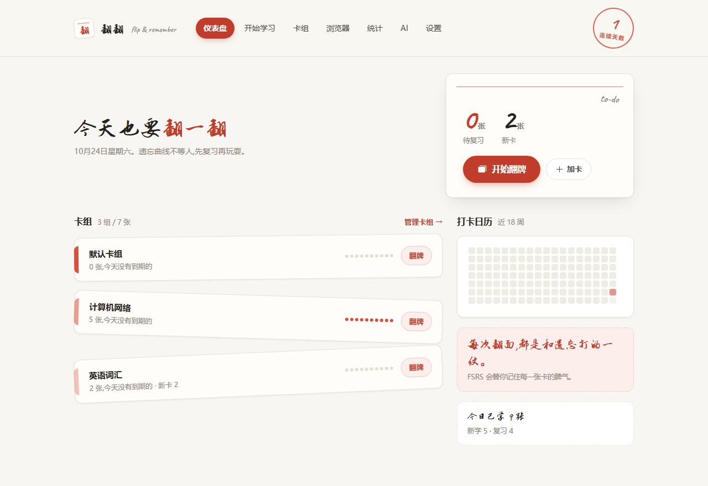
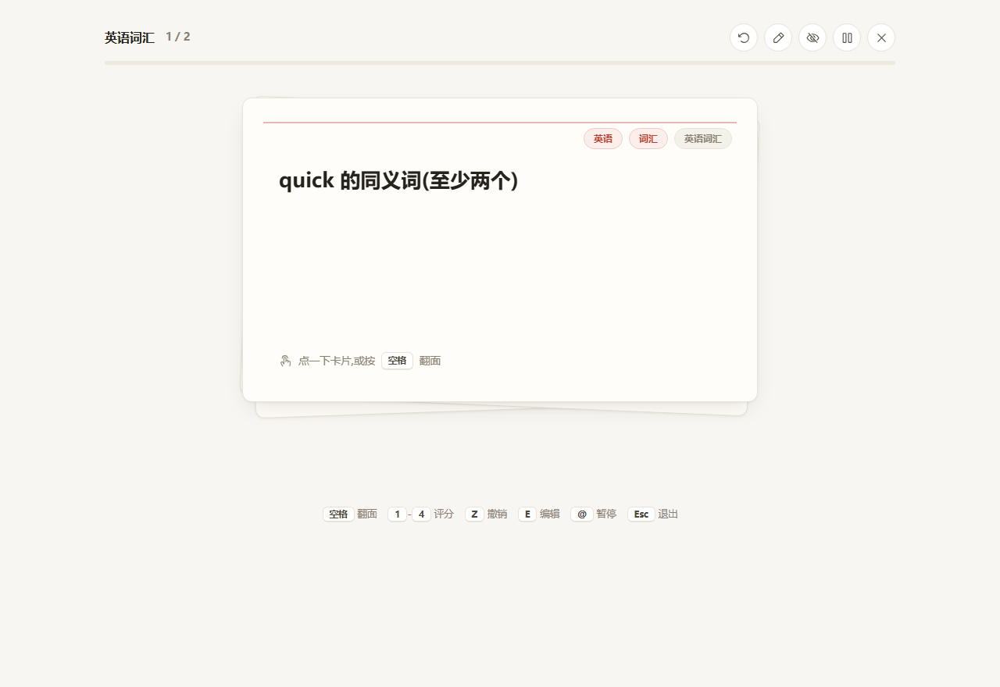
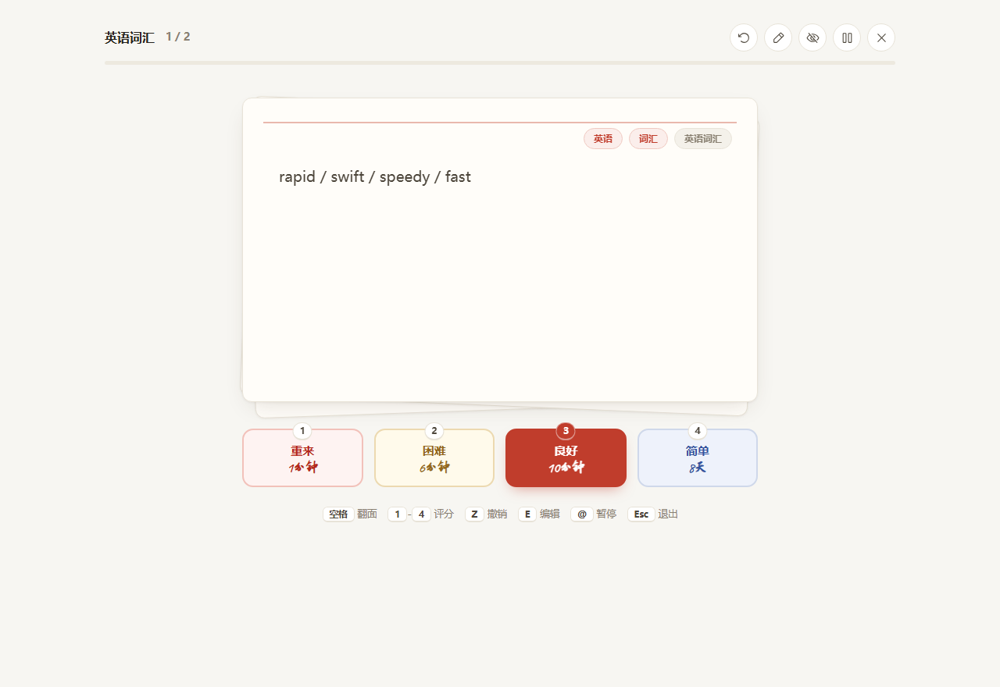
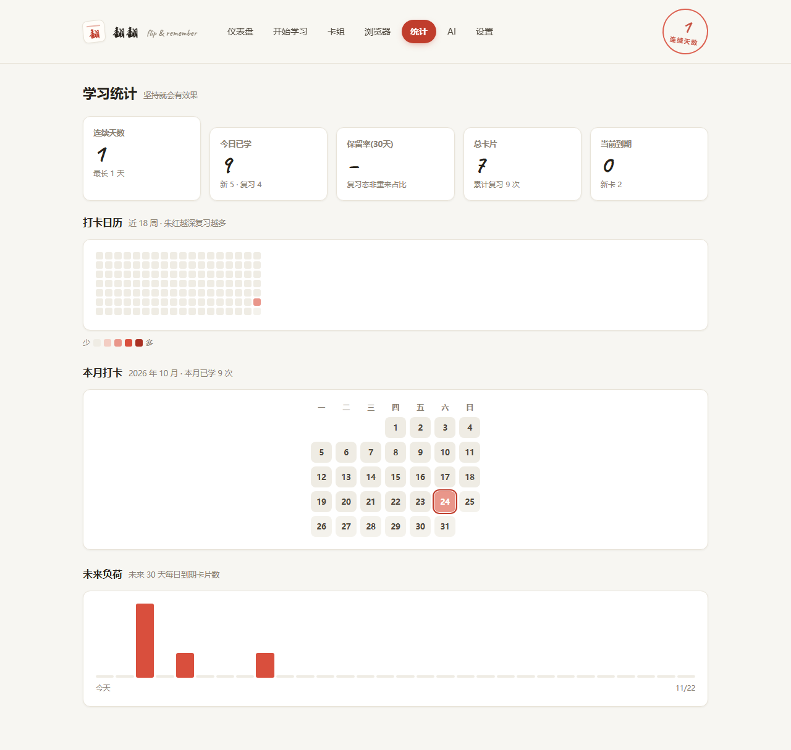

# 翻翻 FanFan

本地运行的间隔重复闪卡学习系统。卡片支持 Markdown、LaTeX 公式和图片,复习由 FSRS 算法调度,数据存在自己电脑上的一个 SQLite 文件里,不依赖任何云服务。



## 界面

学习时点卡片(或按空格)翻面,四个评分按钮会实时显示每种评分对应的下次复习间隔:

| 正面 | 翻面后评分 |
|---|---|
|  |  |

统计页有打卡热力图、连续天数、保留率和未来 30 天的复习负荷:



## 功能

- **卡片**:问答、填空(`{{c1::挖空}}` 语法,多个挖空轮流出题)、双向(一张笔记生成正反两张,进度独立、内容联动);Markdown + KaTeX 公式(`$...$` / `$$...$$`)+ 图片(点击/拖拽/粘贴上传)
- **复习**:FSRS 调度,四键评分带间隔预览,学习步骤,每日新卡/复习上限,新卡与复习卡按 3:1 交织出牌;评分可撤销(会话内多步),可暂停、搁置到明天、重置进度
- **卡组**:支持嵌套(如 `计算机::网络`),改名、移动、删除;在父卡组学习会覆盖全部子卡组
- **浏览器**:搜索、按卡组/标签/状态筛选,批量移动、删除、加标签、暂停,单卡复习历史时间线
- **统计**:打卡热力图(18 周)、连续天数、保留率、未来 30 天负荷、本月打卡日历
- **导入导出**:JSON 全量备份与还原;CSV 导入,兼容 Anki「Notes in plain text」导出文件(自动剥离 HTML)
- **进阶**:FSRS 个性化调参(按自己的复习历史拟合参数)、TTS 自动朗读正面、音频卡片(自动/点击播放/作为问题)、每日复习提醒(浏览器通知)、每日自动备份
- **AI 生成卡片**:粘贴一段笔记,生成闪卡草稿,逐条编辑、勾选后批量入库;支持任意 OpenAI 协议兼容服务,API Key 只存本地、请求全部经后端转发

## 快速开始

需要 Node.js 20+。

```bash
npm install
npm --prefix server install
npm --prefix client install
npm run dev
```

然后浏览器打开 <http://localhost:5173>。前端跑在 5173,后端 API 在 3001,由 Vite 代理转发,没有跨域问题。

首次启动会自动创建数据库和「默认卡组」,直接建卡开始学即可。

## 数据与备份

所有数据在 `server/data/flashcard.db` 一个文件里(含设置、卡组、卡片、复习记录)。备份就是复制这个文件;也可以在设置页导出 JSON,或依赖每日首次启动的自动备份(`server/data/backups/`,默认保留 7 份,可改)。上传的图片和音频在 `server/uploads/`。

## AI 配置(可选)

设置页填写 Base URL、模型名、API Key 并开启即可,点「测试连接」验证。默认对接 Agnes(`https://api.agnes-ai.cn/v1` + `agnes-3.0-flash`),换 DeepSeek、Ollama 等兼容服务同样可用。

也可以把 Key 放在项目根目录 `.env` 里(不进 git):

```
AGNES_API_KEY=sk-...
TOKENRHYTHM_API_KEY=sk-...
```

设置页保存的 Key 优先于 `.env`;两者都不会出现在任何前端响应或日志里。

## 快捷键(学习页)

| 键 | 作用 |
|---|---|
| `空格` | 翻面 |
| `1` – `4` | 评分(重来 / 困难 / 良好 / 简单) |
| `Z` | 撤销上次评分 |
| `E` | 编辑当前卡 |
| `@` | 暂停当前卡 |
| `Esc` | 退出学习 |

## 技术栈

React 18 + TypeScript + Vite + Tailwind CSS 4 · GSAP(动效)· Express 5 + better-sqlite3 · ts-fsrs(FSRS 调度与参数优化)· react-markdown + KaTeX

## 目录结构

```
├─ client/               前端(React + Vite)
│  └─ src/
│     ├─ components/     卡片、印章、评分条、热力图、编辑器等
│     ├─ pages/          仪表盘 / 学习 / 卡组 / 浏览器 / 统计 / 设置 / AI
│     ├─ hooks/          快捷键、复习提醒
│     └─ api/            接口封装
├─ server/               后端(Express + SQLite)
│  ├─ routes/            卡组 / 卡片 / 学习调度 / 统计 / 导入导出 / 媒体 / 设置 / AI
│  ├─ db.ts              数据库初始化与迁移
│  ├─ fsrs.ts            FSRS 封装
│  └─ backup.ts          自动备份
└─ docs/                 界面截图
```
